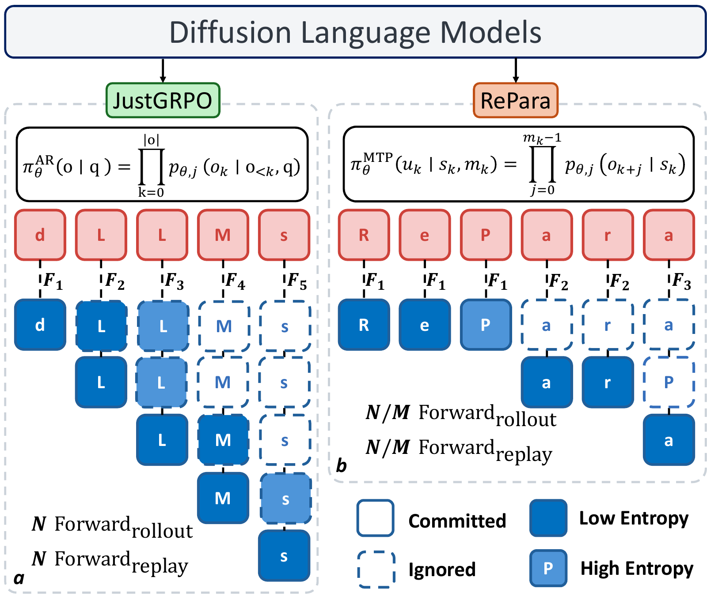
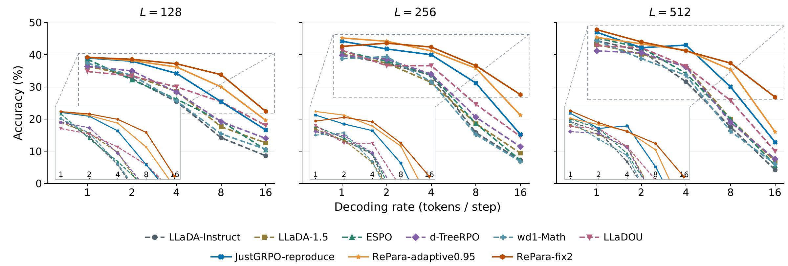
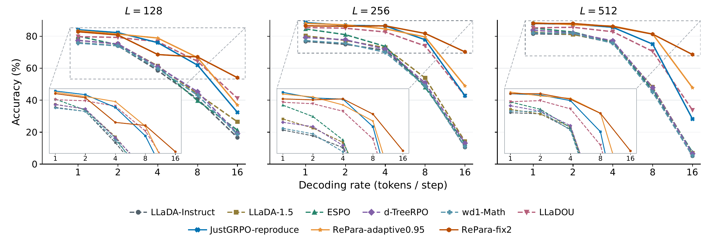
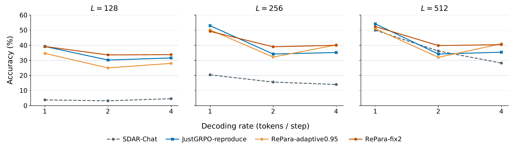
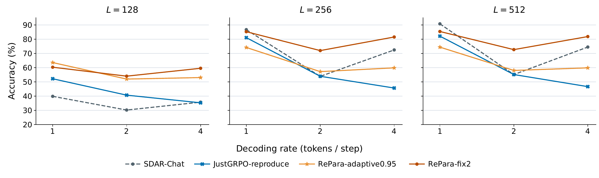

# RePara

**A Few More Tokens Ahead: Reinforcing Parallelism in Diffusion Language Models**

RePara trains diffusion language models to generate short, consecutive token blocks in parallel and optimize their joint probabilities with group-relative reinforcement learning. The paper studies how this improves mathematical reasoning when inference uses fewer denoising steps. This repository provides full-parameter training, evaluation, and training observability for LLaDA and SDAR.

The implementation builds on [JustGRPO](https://github.com/LeapLabTHU/JustGRPO). See [release scope and provenance](docs/release-scope.md) for the code included in this release and [validation](docs/validation.md) for the checks performed.

## Method overview

<p align="center">
  
</p>

JustGRPO commits one token per forward. RePara samples a consecutive block from a shared masked state, records its boundaries, and reconstructs that state to learn the block's joint probability. **Fix** uses a fixed block cap; **Adaptive** accepts the longest confident prefix with a one-token fallback. The diagram is rasterized from the paper's original overview figure.

## Paper results

The table below reports the paper's trained JustGRPO/RePara results, using step-128 checkpoints, a 512-token generation budget, and temperature-zero evaluation. **Fix2 denotes a training block size of two**; the inference quota is shown separately.

| Backbone | Training              | Nominal inference quota | GSM8K accuracy (%) | MATH-500 accuracy (%) |
| -------- | --------------------- | ----------------------: | -----------------: | --------------------: |
| LLaDA    | JustGRPO              |                      16 |              28.20 |                 12.80 |
| LLaDA    | RePara Fix2           |                      16 |          **68.54** |             **26.80** |
| SDAR     | JustGRPO              |                       4 |              46.63 |                 35.40 |
| SDAR     | RePara Fix2           |                       4 |          **81.80** |                 40.40 |
| SDAR     | RePara Adaptive2-0.95 |                       4 |              59.82 |             **41.00** |

LLaDA uses fixed-quota confidence decoding in 32-token windows. SDAR uses native four-token blocks with dynamic confidence selection: quota `q = 4 / denoising_steps` is nominal, and the confidence threshold can commit more tokens per round. Comparisons within each backbone use the same inference protocol.

The paper's LLaDA mathematical training measurement on 64 H200 GPUs reports a **1.96× full-step speedup** for Fix2 over JustGRPO. These historical measurements are separate from this repository's release checks. See [paper results and figure sources](docs/paper-results.md) for protocols, the reported score snapshot, and timing details.

The plots below also show the base models and released baseline checkpoints re-evaluated under the paper's generation budgets.

### LLaDA



_MATH-500: panels use generation budgets 128, 256, and 512; the horizontal axis is the nominal decoding rate `L/S`. Insets magnify the highlighted accuracy ranges._



_GSM8K uses the same panel layout, axis, and legend as the MATH-500 figure above._

### SDAR



_MATH-500: panels use generation budgets 128, 256, and 512; the horizontal axis denotes nominal quotas under native four-token dynamic confidence decoding._



_GSM8K uses the same panel layout, axis, and legend as the MATH-500 figure above. All four plots are rasterized from the paper's source PDFs._

The code also implements code training and evaluation. The paper does not establish consistent accuracy–efficiency gains on code generation.

## Installation

Use a Python environment with a CUDA-compatible PyTorch installation. Common training packages, including PyTorch 2.8.0, are pinned in `requirements.txt`. For LLaDA, install the model profile, which also includes pytest for repository checks:

```bash
python -m pip install -r requirements-llada.txt
```

For SDAR, install the common packages, initialize its pinned native generator dependency, and install FlashAttention in the same environment:

```bash
python -m pip install -r requirements.txt
git submodule update --init third-party/sdar
python -m pip install --no-build-isolation -r requirements-sdar.txt
```

Model weights, training data, and mathematical benchmark inputs are supplied separately. The existing HumanEval and MBPP evaluation files are retained under `datasets/`. Model loading uses the checkpoint's custom model code (`trust_remote_code=True`). Keep each model's tokenizer and custom files with its weights.

## Train

Start with `configs/train/llada/gsm8k/repara-llada-gsm8k-fix2.yaml`. Set its `model_path`, `gsm8k_data_path`, and `output_dir` to your local locations. Set `batch_size_per_device` and `grad_accumulation` for your GPU count.

Edit the lowercase parameter block in [scripts/run_train.sh](scripts/run_train.sh), including `config_path`, `accelerate_config_path`, and the process topology, then run:

```bash
bash scripts/run_train.sh
```

The default launcher uses eight GPU processes and `configs/runtime/fsdp.yaml`. The example batch topology is `8 × 1 × 8 = 64` prompts per optimizer step. All training configurations enforce:

```text
world_size × batch_size_per_device × grad_accumulation = 64
```

With 16 generations per prompt, one optimizer step uses 1,024 completions. Training performs one on-policy update per rollout group. The standard recipes run 128 optimizer steps with a 256-token response budget.

For SDAR, choose an SDAR training configuration and set `accelerate_config_path=configs/runtime/fsdp_sdar.yaml` in the launcher. Keep the model's native attention block size separate from RePara's `mtp_block_size`.

Recipe names follow these patterns:

| Recipe                               | Example                                                         |
| ------------------------------------ | --------------------------------------------------------------- |
| JustGRPO                             | `configs/train/llada/gsm8k/justgrpo-llada-gsm8k.yaml`           |
| Fixed blocks                         | `configs/train/llada/gsm8k/repara-llada-gsm8k-fix2.yaml`        |
| Adaptive blocks                      | `configs/train/llada/gsm8k/repara-llada-gsm8k-adaptive095.yaml` |
| SDAR native block 32                 | `configs/train/sdar/gsm8k/repara-sdar-b32-gsm8k-fix2.yaml`      |
| Method schedule                      | `configs/train/llada/code/repara-llada-code-fade32.yaml`        |
| New Fix4 stage initialized from Fix2 | `configs/train/llada/math/repara-llada-math-fix2-to-fix4.yaml`  |

Recipes for MATH, code, confidence thresholds, and Fix4 are organized under `configs/train/<model>/<task>/`. See [training and evaluation protocols](docs/protocol.md) for data formats, method semantics, and logging, and [checkpoint continuation](docs/checkpoints.md) for restarting an interrupted run.

## Evaluate

Choose a configuration in `configs/eval/`, set its checkpoint, dataset, and output paths, and edit `config_path` and process topology in [scripts/run_eval.sh](scripts/run_eval.sh):

```bash
bash scripts/run_eval.sh
```

For example, `configs/eval/llada/gsm8k/justgrpo-llada-gsm8k.yaml` evaluates confidence-based diffusion at response budgets 128, 256, and 512 and nominal token quotas 1, 2, 4, 8, and 16. The model is loaded once for the sweep. Fixed/adaptive evaluation configurations and SDAR native configurations are supplied separately.

For a checkpoint override without editing the YAML:

```bash
torchrun --standalone --nproc-per-node=8 eval.py \
  --config configs/eval/llada/gsm8k/justgrpo-llada-gsm8k.yaml \
  --ckpt_path outputs/repara-llada-gsm8k-fix2/ckpt-000128 \
  --output outputs/eval/llada-gsm8k-fix2-checkpoint
```

Evaluation defaults to temperature zero, one completion per problem, and a per-process sample batch of one. Inspect the resolved configuration in each output directory when comparing decoding protocols.

## Attribution and license

The code is distributed under the [MIT license](LICENSE). The existing upstream copyright notice is retained. RePara extends JustGRPO with consecutive-block rollout and learning, adaptive confidence selection, SDAR integration, staged schedules, and reproducibility tooling. Task utilities also retain their source attribution in the corresponding files.
